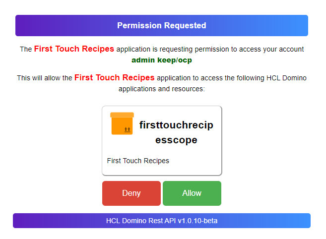

# Customize OAuth consent screen

!!! warning "Important"

    Modifying the look and feel of the consent screen is a complex process and should only be attempted due to corporate identity requirements. Proceed with caution and ensure you are proficient in HTML, CSS, CSP, and JavaScript.

{: style="height:60%;width:60%"}

The OAuth consent screen, as shown by the example image above, uses 3 files:

- `authorization.html` located in `resources/oauth`
- `authorization.css` located in `resources/webroot`
- `authorization.js` located in `resources/webroot`

They are located inside the jar or the container and need to be [extracted](https://www.wikihow.com/Extract-a-JAR-File) from there. You can't modify the original file.

The most likely change might be adjustment of the CSS values. You must do this in a CSS file. The [CSP](https://developer.mozilla.org/en-US/docs/Web/HTTP/CSP) doesn't entertain inline styles. Host your custom CSS in `keepweb.d`, so it is accessible on the same host.

The HTML file uses the [Mustache](https://mustache.github.io/) templating system to fill in the values for the current consent request. In a nutshell: Mustache variables look like this: **&#123;&#123;&nbsp;&#125;&#125;**. A good introduction tutorial [can be found here](https://www.baeldung.com/mustache).

## About this task

Steps to be taken to alter the look & feel of the consent screen

## Prerequisites

- Proficiency in using HTML, CSS, CSP, and JavaScript

- Understanding of [Mustache](https://mustache.github.io/)
- Understanding of the URLs of the Domino REST API and the difference between a file location and its URL

!!! error "Content Security Policy in place!"

    The consent screen uses a tight [CSP](https://developer.mozilla.org/en-US/docs/Web/HTTP/CSP). You can't use inline CSS or JavaScript, or load CSS or JavaScript from a different server.

## Procedure

Two steps are required. The first is to configure the REST API to load an alternate screen. The second is to create the modified screen. In the simplest case, this involves editing the HTML file and pointing to a different or additional CSS file. In the worst case, modifying the JavaScript is also possible, but strongly discouraged.

### Pointing to a different HTML file

You need to create or edit a JSON file in `keepconfig.d` that has the `oauth` key. This can be an existing file with `oauth` or a new and otherwise empty file

```json
{
  "oauth": {
    "alternateConsentDir": "some-directory-that-must-exist"
  }
}
```

That directory must contain you custom `authorization.html`. It doesn't need to be accessible via HTTP or HTTPS, since the REST task picks it up. You can use `keepconfig.d` for this. For CSS and JavaScript files, you need HTTP or HTTPS accessible locations like `keepweb.d` that's [visible](../../references/usingdominorestapi/keepapplications.md#hosting-static-applications) as `/keepweb`.

!!! tip "Use a name matching the purpose"

    Use a filename for the JSON file that reveals its purpose. To learn more on how JSON files in `keepconfig.d` are processed, see [Configuration management and overlay hierarchy](../../references/configuration/understandingconfig.md).

### Modifying the HTML files

The HTML file contains only HTML and links to CSS and JavaScript. It does not contain inline CSS or inline JS. The HTML body consists of 4 main sections:

- error DIV: usually hidden, shows up when things go wrong
- `splashScreen` : initial screen shown while consent is checking if there is an active user session or an existing consent
- `loginScreen` : initially hidden, and shows up when user needs to log in
- `consentScreen` : initially hidden, and shows up when user needs to provide their consent. Contains `{{ mustache }}` variables.

### List of Mustache variables

| Name | Purpose |
| --- | --- |
| `{{ client_name }}` | Application name as configured in the Admin UI. |
| `{{ claims }}` | Repeating element for each requested scope. Use a closing `{{ claims }}` tag to mark the end of the element. |
| `{{ logoURL }}` | Points to the scope icon configured in the Admin UI. |
| `{{ claim }}` | Scope name as configured in the Admin UI. |
| `{{ description }}` | Scope description as configured in the Admin UI. |
| `{{ client_id }}` | `UniqueId` of the requesting application. |
| `{{ state }}` | Application state required by the OAuth flow. Don't modify. |
| `{{ redirect_uri }}` | Redirect URI configured in the Admin UI. It directs the user back to the application. Don't modify. |
| `{{ scope }}` | Requested scopes matched against the application configuration. Don't modify. |
| `{{ response_type }}` | Response type required by the OAuth flow. Don't modify. |

Don't alter any of the input fields or the button IDs. You can modify anything inside the `form` tag before the first `input` element.

!!! tip

    If you encounter any issues with the OAuth consent screen, you can revert to the default settings by removing the `alternateConsentDir` in the `oauth` section of your JSON configuration file.
